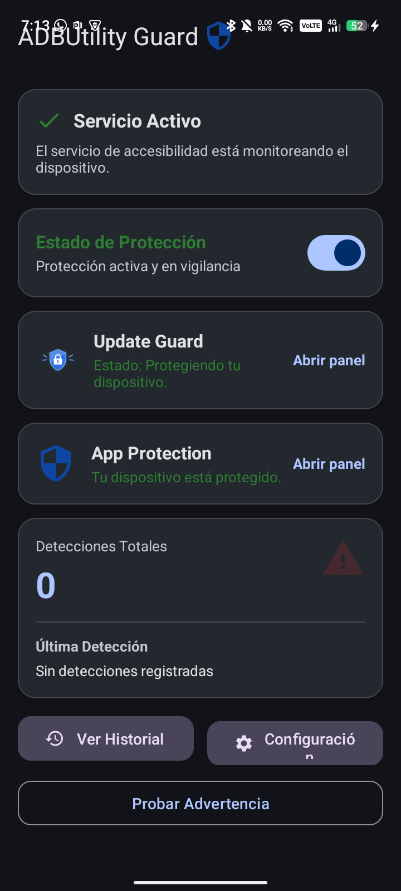
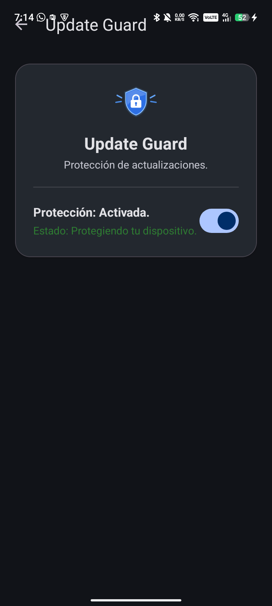
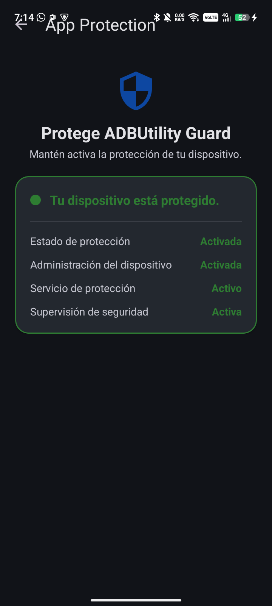
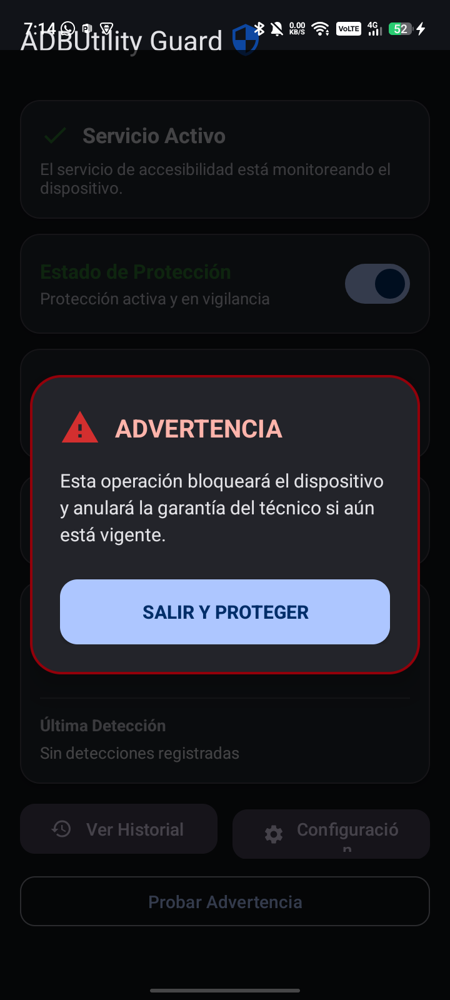

# ADBUtility Guard

**ADBUtility Guard** es una aplicación Android diseñada como complemento de **ADB UtilityTools**. Supervisa de forma autónoma pantallas críticas de los Ajustes del sistema, actualizaciones del sistema operativo y protección contra desinstalación sin requerir acceso Root, Device Owner, Shizuku ni Android Studio.

---

## Capturas en Funcionamiento

> Capturas tomadas directamente desde un dispositivo Android 15 (TECNO Spark 40) vía ADB.

| Panel Principal | Update Guard | App Protection | Advertencia Flotante |
| :---: | :---: | :---: | :---: |
|  |  |  |  |

---

## 1. Módulos y Características Principales

### Protección de Restablecimiento y DNS Privado (`ResetDetector` + `OverlayController`)
- **Supervisión por Accesibilidad (`ResetAccessibilityService`)**: Detecta el acceso a pantallas de restablecimiento de fábrica, borrado general de datos y modificación de DNS privado en Ajustes.
- **Advertencia Flotante Material 3 (`TYPE_ACCESSIBILITY_OVERLAY`)**: Despliega una alerta de alta visibilidad con salida segura (`SALIR Y PROTEGER`) que cierra la app de Ajustes para evitar bucles al volver a abrir Ajustes.
- **Cobertura Multi-OEM**: Reglas para AOSP, Samsung One UI, Xiaomi HyperOS/MIUI, TECNO/HiOS, Motorola, OPPO/ColorOS y soporte en español e inglés.

### Update Guard (`updateguard`)
- **Smart Update Detection Engine (`SmartUpdateDetection`, `UpdateRiskClassifier`, `UpdateTextDetector`)**: Clasifica ventanas en cuatro categorías (`SYSTEM_UPDATE`, `APP_UPDATE`, `APK_INSTALL`, `UNKNOWN`) usando múltiples señales contextuales (paquete, actividad/clase, IDs de vistas, etiquetas de botones y jerarquía del árbol).
- **Bloqueo selectivo sin romper apps**:
  - Cubre únicamente botones peligrosos de actualización del sistema / OTA / firmware (por ejemplo, *"Reiniciar ahora"* en diálogos OTA del sistema o Google Play Services `com.google.android.gms/.update.phone.PopupDialog`) mediante escudos transparentes de accesibilidad (`UpdateAccessibilityOverlay`) y muestra un diálogo informativo descartable (`UpdateWarningController` / `UpdateBlockedDialog`).
  - Permite con normalidad Google Play Store, actualizaciones de aplicaciones desde tiendas e instalaciones APK o por ADB.
- **Detección al reconectar**: Inspecciona de inmediato la ventana activa y ventanas visibles al conectar el servicio (`onServiceConnected`).

### App Protection (`protection` + `admin`)
- **Device Admin oficial (`GuardDeviceAdminReceiver`, `DeviceAdminManager`)**: Exige desactivar primero la administración del dispositivo antes de desinstalar la aplicación, con descripciones de alcance claras en Ajustes.
- **Monitorización sin consumo continuo (`ProtectionMonitor`, `AppProtectionAccessibilityMonitor`, `ProtectionWarningManager`)**: Evalúa el estado real (`FULL_PROTECTION`, `PARTIAL_PROTECTION`, `UNPROTECTED`) combinando Device Admin, Accesibilidad y notificaciones, apoyado en comprobaciones periódicas con WorkManager.
- **Panel dedicado (`AppProtectionActivity`)**: Muestra el estado desglosado y permite reactivar capas de protección en caso de pérdida.

### Integración ADB y Electron (`AdbCommunication`)
- Expone `GuardContentProvider` (`adb shell content call`) y `AdbQueryReceiver` (`adb shell am broadcast`) en modo de **solo lectura** para consultar versión, estado del servicio, última detección e historial en formato JSON.

---

## 2. Arquitectura del Proyecto

```text
app/src/main/java/com/adbutility/guard/
├── MainActivity.kt                        # Dashboard principal Material 3
├── ResetAccessibilityService.kt           # Servicio único de accesibilidad compartido
├── ResetDetector.kt                       # Detector de restablecimiento y DNS privado
├── ResetGuardManager.kt                   # Orquestador singleton de módulos
├── OverlayController.kt                   # Ventana flotante de advertencia de Ajustes
├── OverlayWarningView.kt                  # Vista del overlay principal
├── AdbCommunication.kt                    # Consultas JSON seguras para ADB / Electron
├── DeviceInfo.kt                          # Información de fabricante, SDK y capa OEM
├── EventLogger.kt                         # Historial local de detecciones
├── HistoryAdapter.kt                      # Adaptador RecyclerView del historial
├── PreferencesManager.kt                  # Preferencias persistentes generales
├── accessibility/
│   └── AppProtectionAccessibilityMonitor.kt
├── admin/
│   ├── DeviceAdminManager.kt
│   ├── DeviceAdminStatus.kt
│   └── GuardDeviceAdminReceiver.kt
├── data/
│   ├── DetectionDatabaseHelper.kt
│   └── DetectionEvent.kt
├── protection/
│   ├── ProtectionMonitor.kt
│   ├── ProtectionRecoveryManager.kt
│   ├── ProtectionRepository.kt
│   ├── ProtectionState.kt
│   └── ProtectionWarningManager.kt
├── provider/
│   └── GuardContentProvider.kt
├── receiver/
│   ├── AdbQueryReceiver.kt
│   └── BootReceiver.kt
├── ui/
│   ├── protection/
│   │   ├── AppProtectionActivity.kt
│   │   └── ProtectionStatusCard.kt
│   └── updateguard/
│       ├── UpdateBlockedDialog.kt
│       └── UpdateGuardActivity.kt
└── updateguard/
    ├── SmartUpdateDetection.kt
    ├── UpdateAccessibilityOverlay.kt
    ├── UpdateEventLogger.kt
    ├── UpdateGuardEngine.kt
    ├── UpdateGuardSettings.kt
    ├── UpdatePackageRegistry.kt
    ├── UpdateRiskClassifier.kt
    ├── UpdateTextDetector.kt
    └── UpdateWarningController.kt
```

---

## 3. Compilación SIN Android Studio

El proyecto incluye Gradle Wrapper (`gradlew.bat` / `gradlew`) y scripts de automatización para Windows y Linux/macOS.

### Requisitos
- **JDK 17 o JDK 21** (Temurin LTS recomendado).
- **Android SDK** con Platform 35 y Build-Tools instalados.
- **ADB** en el PATH o dentro de `platform-tools` para instalación en dispositivo.

### Windows (PowerShell)
```powershell
.\setup.ps1           # Detecta JDK/SDK y genera local.properties
.\build-debug.ps1     # Compila app/build/outputs/apk/debug/app-debug.apk
.\build-release.ps1   # Compila app/build/outputs/apk/release/app-release.apk
.\install.ps1         # Instala el APK en el dispositivo conectado por ADB
.\clean.ps1           # Limpia artefactos de compilación
```

### Linux / macOS (Bash)
```bash
chmod +x *.sh ./gradlew
./setup.sh
./build-debug.sh
./build-release.sh
./install.sh
./clean.sh
```

---

## 4. Pruebas Unitarias

Las pruebas unitarias cubren las reglas de **Smart Update Detection** y **App Protection**:

```bash
# Windows
.\gradlew.bat testDebugUnitTest

# Linux / macOS
./gradlew testDebugUnitTest
```

Suites principales:
- `app/src/test/java/com/adbutility/guard/updateguard/SmartUpdateDetectionTest.kt`
- `app/src/test/java/com/adbutility/guard/protection/AppProtectionTest.kt`

---

## 5. Configuración de Firma Release (Sin Subir Secretos a Git)

`keystore.properties`, `*.keystore`, `*.jks` y `local.properties` están excluidos en `.gitignore`. Nunca subas claves privadas ni contraseñas al repositorio.

1. **Generar tu almacén de claves local:**
   ```bash
   keytool -genkey -v -keystore release.keystore -alias guard -keyalg RSA -keysize 2048 -validity 10000
   ```
2. **Crear `keystore.properties` en la raíz del proyecto:**
   ```properties
   storeFile=release.keystore
   storePassword=TU_PASSWORD_ALMACEN
   keyAlias=guard
   keyPassword=TU_PASSWORD_CLAVE
   ```
   *(Como alternativa en CI/CD, puedes definir las variables de entorno `KEYSTORE_FILE`, `KEYSTORE_PASSWORD`, `KEY_ALIAS` y `KEY_PASSWORD`. Si no existen credenciales configuradas, Gradle usa firma debug de respaldo).*

---

## 6. Activación e Integración por ADB

### Activar Accesibilidad y Device Admin tras instalar
```bash
adb install -r -d -g app/build/outputs/apk/release/app-release.apk
adb shell settings put secure enabled_accessibility_services com.adbutility.guard/com.adbutility.guard.ResetAccessibilityService
adb shell settings put secure accessibility_enabled 1
adb shell am start -n com.adbutility.guard/.MainActivity
```

### Consultas de estado (`ContentProvider`)
```bash
adb shell content call --uri content://com.adbutility.guard.provider --method getVersion
adb shell content call --uri content://com.adbutility.guard.provider --method getStatus
adb shell content call --uri content://com.adbutility.guard.provider --method getLastDetection
adb shell content call --uri content://com.adbutility.guard.provider --method getHistory --arg 20
```

---

## 7. Alcance y Limitaciones

- No utiliza privilegios **Root**, **Device Owner** ni **Shizuku**; opera sobre APIs públicas de Android (`AccessibilityService` y `DevicePolicyManager`).
- **Actualizaciones y Factory Reset por botones físicos / Recovery**: Un restablecimiento desde modo Recovery o una actualización A/B cuyo slot ya quedó preparado antes de reiniciar no pueden interceptarse desde el espacio de usuario una vez que el bootloader asume el control.
- **Desactivación manual**: Si el usuario desactiva manualmente Device Admin y el Servicio de Accesibilidad en Ajustes, la protección queda en estado `PARTIAL_PROTECTION` / `UNPROTECTED` y se notifica al volver a la aplicación.
